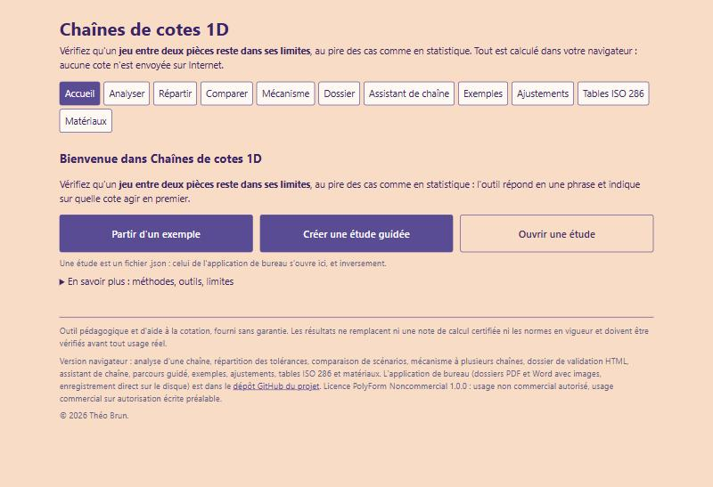
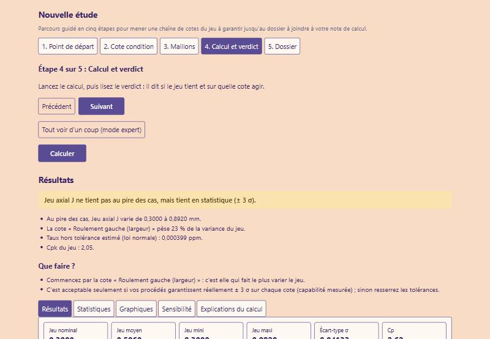
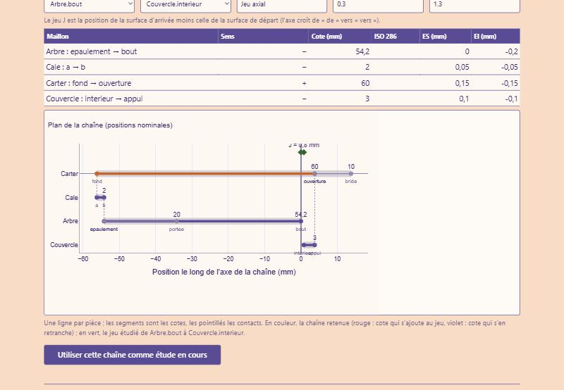
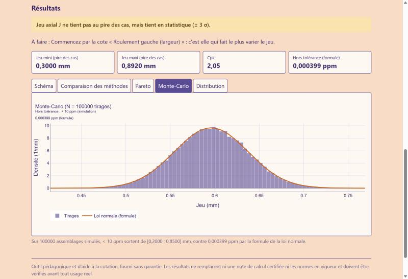
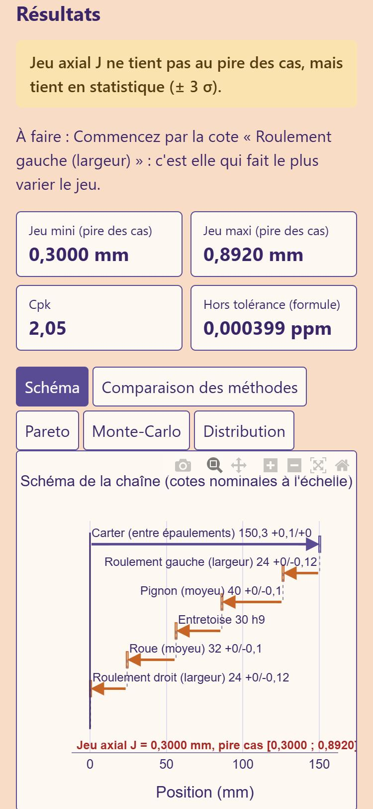

# Chaînes de cotes 1D

**Le jeu entre deux pièces reste-t-il dans ses limites ?** Cet outil calcule une chaîne de cotes à une dimension et
répond en une phrase : au pire des cas, en statistique, ou pas du tout, avec la cote sur laquelle agir en premier.

[](https://theo33-oss.github.io/chaines-de-cotes-1D/)
[](LICENSE)



## À quoi ça sert

- **Dimensionner un jeu** (un jeu axial, un serrage, un dépassement) à partir des cotes et des tolérances des pièces.
- **Choisir entre sécurité et coût** : tolérances serrées et chères (pire des cas) ou plus larges avec un petit taux
  de rebut accepté (statistique, Monte-Carlo).
- **Savoir quelle cote pèse le plus**, pour ne resserrer que celle-là.
- **Répartir les tolérances** pour tenir un jeu imposé, au moindre coût si besoin, et **justifier** le résultat par un
  dossier de validation qui refait les calculs sans le solveur.

## Essayer en 1 minute

1. Ouvrez la [page web](https://theo33-oss.github.io/chaines-de-cotes-1D/). Le premier chargement prend 10 à 30
   secondes (Internet nécessaire), puis le message « Prêt » apparaît.
2. Cliquez sur **Créer une étude guidée** pour être mené en cinq étapes, ou sur **Partir d'un exemple** puis
   **Ouvrir dans Analyser** sous la carte **Réducteur : jeu axial d'un arbre intermédiaire**.
3. Lisez le verdict : le jeu ne tient pas au pire des cas (0,3000 à 0,8920 mm pour 0,20 à 0,85 mm demandés), mais tient
   en statistique (Cpk 2,05). « Que faire ? » indique par quelle cote commencer.
4. Passez d'un onglet à l'autre : résultats, statistiques (Monte-Carlo, inertiel), graphiques, sensibilité, explications
   du calcul avec les formules remplies. **Enregistrer l'étude** produit le même fichier `.json` que l'application de
   bureau.



## Ce que contient la version navigateur

| Page | Ce qu'elle fait |
|---|---|
| **Accueil** | Trois actions pour démarrer ; méthodes, outils et limites d'usage sous « En savoir plus » |
| **Analyser** | Saisie de la chaîne (ISO 286, matériaux, effet thermique, décentrage), schéma et contrôles en direct, verdicts, Pareto, Monte-Carlo, sensibilité, explications pas à pas ; mode guidé en cinq étapes |
| **Répartir** | Calcule les tolérances qui tiennent [Jmin ; Jmax] : égale, proportionnelle, qualité ISO la plus proche ou coût minimal par procédé ; maillons figés, maillon de réglage, valeurs d'atelier gardées dans le navigateur |
| **Comparer** | L'étude en cours contre le résultat de la répartition, un exemple ou un fichier : écarts sur le jeu, le Cpk et chaque tolérance |
| **Mécanisme** | Plusieurs chaînes d'un même assemblage calculées ensemble ; tableau de bord des Cpk, chaîne la plus fragile, export CSV |
| **Dossier** | Dossier de validation HTML : chaque grandeur est refaite à la main puis comparée au solveur (32 contrôles sur le réducteur, références MATLAB comprises) |
| **Assistant de chaîne** | Des pièces, de leurs cotes et de leurs contacts à la chaîne minimale, avec le plan |
| **Exemples** | 9 exemples avec leur méthodologie |
| **Ajustements** | Ajustements ISO 286 classés selon la fonction souhaitée, avec jeux et schéma |
| **Tables ISO 286** | Calculatrice d'écarts, tableau des IT, écarts fondamentaux |
| **Matériaux** | 93 matériaux : α, domaine d'emploi, courbes de dilatation |



## Les méthodes

| Méthode | Question à laquelle elle répond | Principe |
|---|---|---|
| **Pire des cas** | Le jeu est-il garanti à 100 % ? | Toutes les cotes au plus mauvais en même temps : demi-dispersion Σ \|aᵢ\|·ITᵢ / 2 autour du jeu moyen |
| **Statistique (RSS ± kσ)** | Quel taux de pièces hors tolérance ? | σᵢ = \|aᵢ\|·ITᵢ / 2k, σⱼ = √Σσᵢ², avec Cp, Cpk et ppm |
| **Monte-Carlo** | La formule tient-elle avec des lois non normales ? | 100 000 à 200 000 assemblages tirés au hasard (lois normale, uniforme ou triangulaire) |
| **Effet thermique** | Le jeu change-t-il avec la température ? | Dilatation de chaque maillon d'après les courbes de 93 matériaux |

Les tolérances viennent de l'ISO 286 (IT1 à IT18, positions a à zc et A à ZC) ou des écarts ES / EI saisis.



## Deux façons de l'utiliser

| | Version navigateur | Application de bureau (Windows) |
|---|---|---|
| **Où** | [Page GitHub Pages](https://theo33-oss.github.io/chaines-de-cotes-1D/) : Chrome, Firefox, Edge, Safari, téléphone | Dossier [`application/`](application) |
| **Installation** | Aucune | Python 3.11 ou plus, installé au premier lancement (environ 1 Go) |
| **Calcul** | Le même code Python, exécuté dans le navigateur | Le même code Python |
| **Seulement sur le bureau** | | Dossiers PDF et Word avec images des graphiques, exports Excel (résultats, tableau de bord, feuille de chaîne, cotation), dérive et re-réglage, mesures de l'atelier (σ et moyenne), coefficients de projection (levier, angle), tolérances géométriques ISO 1101, import Excel des maillons, historique de révisions, enregistrement direct sur le disque |

Dans les deux cas, **tout est calculé sur votre ordinateur** : aucune cote n'est envoyée sur Internet. Un fichier
d'étude enregistré dans l'une des versions s'ouvre dans l'autre ; les champs que la page web ne modifie pas (dérive,
mesures d'atelier, levier, angle, géométrie) sont conservés et réenregistrés tels quels.



## Version navigateur

Le dossier [`docs/`](docs) est la page publiée par GitHub Pages. Elle exécute dans le navigateur, avec
[Pyodide](https://pyodide.org), **le même code Python** que l'application de bureau : mêmes résultats, mêmes exemples,
rien n'est réécrit en JavaScript. Le JavaScript ne fait que l'affichage ; `docs/pont.py` relie les deux.

Essai en local :

```bash
python -m http.server 8000 --directory docs
```

puis ouvrir <http://localhost:8000>. Après toute modification de `application/chainecotes`, de `application/data` ou de la
page, reconstruire le calcul et versionner les scripts :

```bash
python construire_web.py
```

`essai_pont.py` fait passer tous les exemples par les fonctions de la page, sans navigateur.

## Application de bureau

Double-cliquer sur `1_Ouvrir_application.bat` (voir [`LISEZ-MOI.txt`](LISEZ-MOI.txt)). Elle s'ouvre dans sa propre
fenêtre, sans navigateur. Les calculs sont vérifiés par plus de 4 400 tests automatiques :

```bash
cd application
python -m venv .venv
.venv/Scripts/python -m pip install -r requirements.txt pytest pytest-qt
.venv/Scripts/python -m pytest -q tests
```

## Limites d'usage

Outil pédagogique et d'aide à la cotation, fourni sans garantie. Une dimension seulement (une chaîne suit un axe),
lois normale, uniforme ou triangulaire indépendantes, dilatation thermique linéaire sans contrainte ni gradient.
Les résultats ne remplacent ni une note de calcul certifiée ni les normes en vigueur et doivent être vérifiés avant
tout usage réel.

## Auteur et licence

Projet de **Théo Brun**, portage en Python de son application MATLAB de chaînes de cotes. Tolérances ISO 286 reprises
de MecaStruct RdM Pro ; coefficients de dilatation sourcés (NIST, Eurocodes, fiches de fabricants).

Licence [PolyForm Noncommercial 1.0.0](LICENSE) : usage non commercial autorisé ; usage commercial sur autorisation
écrite préalable de l'auteur.
